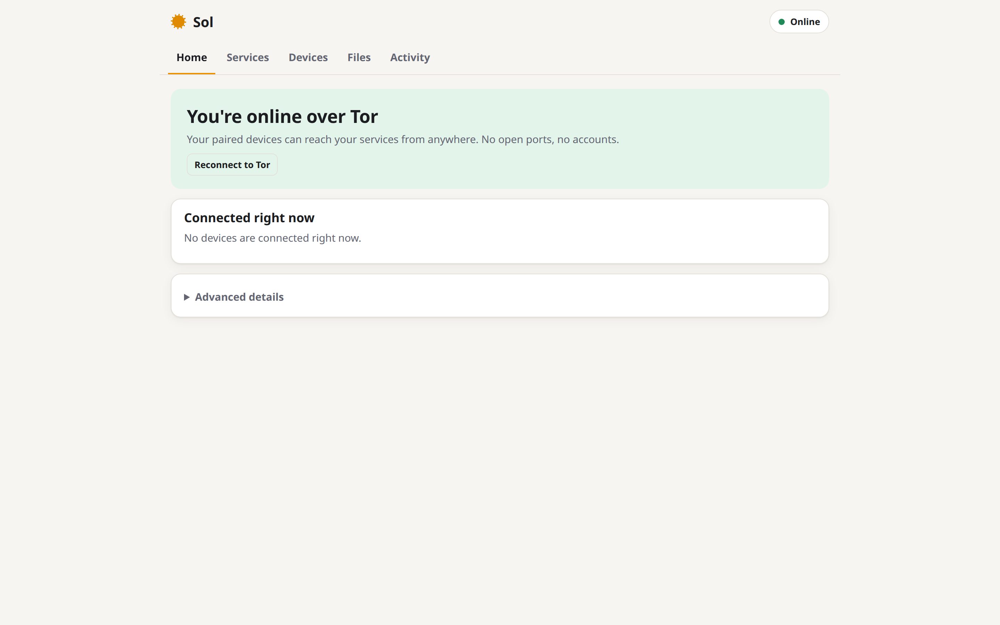
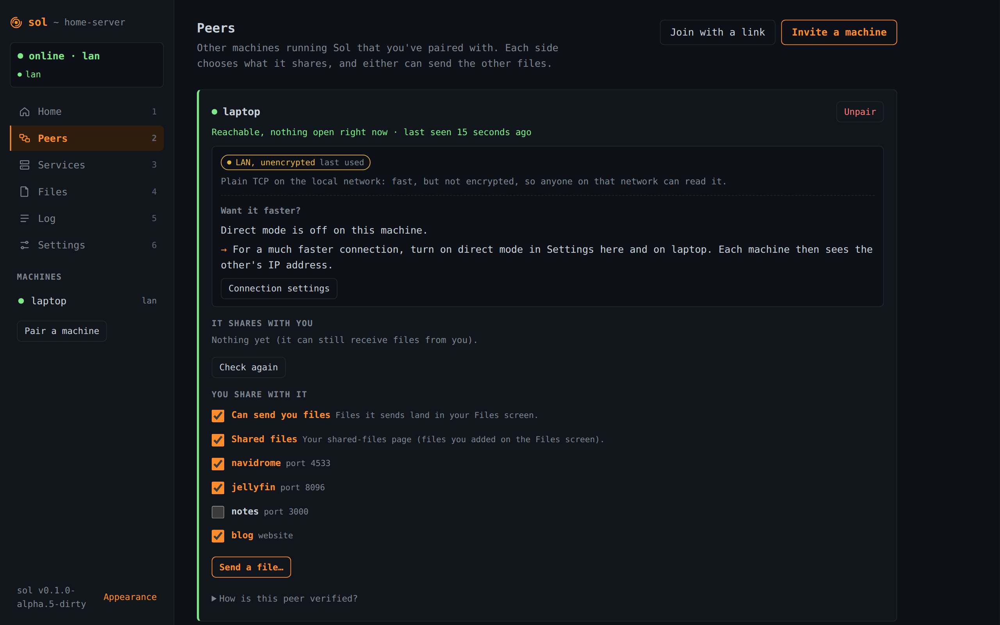
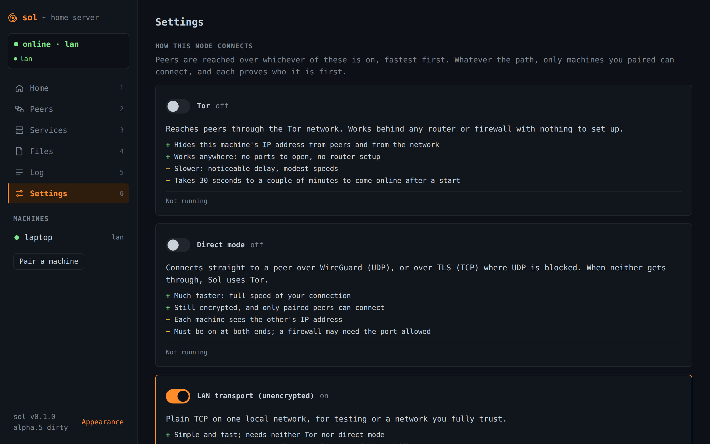

<p align="center"></p>

<h1 align="center">Sol</h1>

<p align="center"><b>Connect your own machines over Tor: open each other's apps, send each other files,
host a site on an onion.</b><br>
No port forwarding, no VPN, no accounts, no domain, no cloud.</p>

<p align="center">
<a href="https://github.com/apv022/sol/actions/workflows/ci.yml"></a>
<a href="https://github.com/apv022/sol/releases"></a>
<a href="LICENSE"></a>


</p>

```
home server (behind CGNAT, no open ports)           your laptop, anywhere
┌──────────────────────────────────────┐            ┌───────────────────────────┐
│ Navidrome :4533 ─┐                   │    Tor     │ sol open home             │
│ Jellyfin  :8096 ─┼─ sol ─ tor ───────┼────────────┼─ localhost:9000 → music   │
│ sshd      :22   ─┘   (outbound only) │  ◄──────►  │ sol send home notes.pdf   │
└──────────────────────────────────────┘  both ways └───────────────────────────┘
```

Sol is one Go binary that runs on each of your machines. Pair two of them once with a one-time
link, and they become **peers**: each can open the apps the other shares with it, and either can
send the other files, through Tor, from anywhere. Nobody else can even find them.

<!-- demo GIF: record with `vhs docs/demo.tape` and replace this comment -->

<p align="center"></p>

> **Early software.** Sol works and its tests pass on Linux. CI covers macOS and
> Windows too, but the newest changes (self-healing Tor and peer links) have so far only been run on
> Linux. Nobody outside the project has reviewed its security yet. [We're asking for that review](SECURITY.md#looking-for-review).

## Why

Self-hosting usually means fighting your router, CGNAT, dynamic DNS, TLS certificates, and VPN
configs, or handing your traffic to a tunnel company. Sol skips all of it:

- **Zero network config.** Sol only makes outbound connections. It works behind CGNAT, on hotel
  Wi-Fi, and on mobile hotspots.
- **Private by default.** A service is invisible to anyone you haven't paired: Tor client
  authorization hides the address, and the handshake drops strangers without a single byte of reply.
- **You choose what each peer sees.** A new peer can only send you files. Tick the apps it may
  open. Unpair a lost laptop and its connections close instantly, on both sides.
- **Files both ways.** `sol send laptop notes.pdf` from any machine, checked by SHA-256 on arrival.
- **Any TCP service.** HTTP, WebSockets, media streaming with seeking, SSH, game servers, databases.
- **Public too, if you want.** Flip a service to `public` and it gets its own `.onion` that anyone
  can open in Tor Browser. It can't be linked to your private node.
- **A website in one command.** `sol site add blog ./public` serves a folder on its own `.onion`,
  with no web server to set up or harden.
- **Small and auditable.** Standard-library Go with one dependency (the official `wireguard-go`,
  for direct mode), and no build step for the UI.

## Quick start

**1. Install** Sol and Tor on each machine.

```sh
curl -fsSL https://raw.githubusercontent.com/apv022/sol/main/install.sh | sh    # Linux, macOS
sudo apt install tor        # or: brew install tor · sudo pacman -S tor · sudo dnf install tor
```

The script downloads the release binary for your system, checks its checksum, and never uses
`sudo`. Other ways: grab an archive from [Releases](https://github.com/apv022/sol/releases)
(Windows included), or build it with Go 1.26+: `go install github.com/apv022/sol/cmd/sol@latest`.
On a phone, there is an alpha [Android app](https://github.com/apv022/sol-mobile).

**2. Start it.**

```sh
sol                       # starts the node in the background; panel at http://127.0.0.1:8080
```

`sol` gives your terminal back. `sol stop` stops the node, `sol logs -f` shows what it is doing,
and `sol autostart on` starts it when you log in.

**3. Pair two machines** (once). On the home server, `sol invite` (or the panel's **Peers → Invite a
machine**) prints a link. On the laptop:

```sh
sol pair 'sol://pair?node=…'          # or paste it in the panel: Peers → Join with a link
```

**4. Share an app.** On the server:

```sh
sol service add navidrome 4533 --http --share laptop
```

(or in the panel: **Services → Add**, then tick it for the laptop on the **Peers** tab). On the
laptop, click **Open** next to it on the **Peers** tab, or:

```sh
sol open home
#   navidrome -> http://127.0.0.1:9000/
```

The tunnel belongs to the node, not the terminal: it stays open, comes back on the same port
after a restart (bookmark it), and heals by itself when the other machine reboots or changes
networks.

**5. Send files**, either way: `sol send home notes.pdf` (or **Send a file…** on the Peers tab).
They show up in the other machine's Files tab, marked with who sent them.

The panel walks you through it: a getting-started checklist, presets for common apps (Navidrome,
Jellyfin, Immich, Home Assistant, SSH…), a warning if the app isn't running, and a live view of
which peers are connected to what, each one cryptographically verified. Every peer and open
tunnel says which path it takes (Tor, WireGuard direct, TLS direct or LAN), what that means for
speed and for who sees your IP address, and, when direct mode isn't carrying it, why not and
what fixes it. While Tor starts you see its real progress, step by step, and when it retries.
**Settings → How this node connects** explains each choice and, before you change one, tells
you whether it needs a restart and which peers would become unreachable. On a phone the panel
has a tab bar and bottom sheets. Its look is yours to change: themes, accent colour, tabs or a
sidebar under **Appearance**, and any CSS you like in `~/.sol/panel.css`.

**6. Publish a site**, if you want one: `sol site add blog ./public` serves that folder on its
own `.onion` address, which anyone can open in Tor Browser.

> The first start takes about 30 seconds while Tor connects. After that a node is online within
> about ten seconds of starting. Your onion address is kept between runs.

Try it without Tor on one LAN: `sol config tor off`, `sol config clearnet on`, `sol restart`.
That's for LAN and testing only, since clearnet traffic is not encrypted.

## How it works

1. Every node runs its own `tor` child process and publishes one **private onion** for itself,
   locked with Tor v3 client authorization.
2. **Pairing is mutual.** Each node has an **ed25519** identity. The link carries the inviter's
   address and an **x25519** Tor key made just for the joiner; the joiner answers with its own
   address and a key it made for the inviter, signed. The link is single use and expires in 10
   minutes.
3. Every connection, either way, begins with a **signed challenge-response handshake**: the callee
   sends a fresh nonce, the caller signs it with the service name, and the callee checks the key is
   a peer and the service is shared with it. Then it's a plain byte pipe to `127.0.0.1:<port>`.
4. **Unpairing** closes live connections on both sides and republishes the onion without the key.

Details: [docs/PEERS.md](docs/PEERS.md) · [docs/PROTOCOL.md](docs/PROTOCOL.md) ·
[docs/ARCHITECTURE.md](docs/ARCHITECTURE.md) · [docs/THREAT_MODEL.md](docs/THREAT_MODEL.md)

## Screenshots

| Peers: what each side shares | Settings |
|---|---|
|  |  |

The panel is one web page served on `127.0.0.1`. Themes, accent colour and layout are under
**appearance**; anything else is yours to restyle in `~/.sol/panel.css`.

## Commands

| Command | What it does |
|---|---|
| `sol` | Start the node in the background (panel on `127.0.0.1:8080`, data in `~/.sol`). Everything below talks to it |
| `sol stop`, `sol restart`, `sol logs [-f]` | Stop it, restart it, or read its log |
| `sol network-changed [reason]` | Tell the running node the network changed (the Android app runs it when the phone switches networks), so it re-checks its connections now |
| `sol run` | Run the node in the foreground instead (what systemd, launchd and containers run) |
| `sol config [key [value]]` | List, show or change settings: Tor, direct mode, STUN servers, ports… The panel's Settings screen changes the same ones |
| `sol invite` | Print a one-time pairing link for another machine |
| `sol pair <link>` | Pair with the machine that made the link |
| `sol peers [-r]` | List peers and what each side shares (`-r` asks them now) |
| `sol services` | List this machine's services and who may open each |
| `sol service add <name> <port> [--http] [--public] [--share PEER]` | Add an app running on `127.0.0.1:<port>` (private unless `--public`) |
| `sol service edit <name> [--port N] [--http\|--tcp] [--rename NEW]` | Change a service in place: peers keep their access and a public one keeps its address (also the panel's **Edit** button) |
| `sol service remove\|public\|private <name>` | Remove a service, or change who can open it |
| `sol site add <name> <folder> [--private] [--record] [--share PEER]` | Serve a folder as a website on its own `.onion` (public unless `--private`). Sol serves the files itself; `--record` adds a signed record of its addresses |
| `sol site edit <name> [--folder DIR] [--record\|--no-record] [--rename NEW]` | Change a site in place |
| `sol site remove <name>` | Stop serving it (the folder isn't touched) |
| `sol files [add <file>… [--name N] [--replace] \| rename <name> <new> \| rm <name>…]` | List, add, rename, replace and delete your shared files (and delete files peers sent); the panel's Files screen does the same |
| `sol share <peer> <service> [--off]` | Let a peer open a service (`_files` = your shared files page) |
| `sol open <peer> [service…] [-L svc=PORT]` | Keep what a peer shares reachable on `127.0.0.1` (ports from 9000; saved, survive restarts) |
| `sol tunnels`, `sol close <peer> [service]` | List tunnels and whether the peer answers; close them |
| `sol send <peer> <file>…` | Send files to a peer |
| `sol unpair <peer>` | Remove a peer here and tell it to remove you |
| `sol autostart on\|off\|status` | Start the node when you log in (systemd user unit on Linux, LaunchAgent on macOS) |
| `sol name [NEW]`, `sol status` | Show or change this machine's name; show its id and addresses |
| `sol snowflake on\|off\|status` | Help the Tor network: run a Snowflake proxy so people in censored countries can reach Tor through this machine (off by default; needs `snowflake-proxy` installed) |
| `sol audit` | Leak checks for anonymous-public services |

`<peer>` is a name or the start of an id. Environment variables: `SOL_DATA` (data dir),
`SOL_DEBUG=1`. Every setting is in `sol config`; you never have to edit `config.json` by hand.

## Status

Sol is **early**. It works and is tested, but it hasn't had an independent security review.

| Feature | Status |
|---|---|
| Tor onion services with client authorization | ✅ |
| Tor restarts itself (failed start, stalled bootstrap, tor exit, frozen control port, network change, wake from sleep) | ✅ tested on Linux (scripted fake tor and the real Tor network) |
| Peer links probed about every 30 s; dead paths redialled; direct falls back to Tor and returns once stable | ✅ tested on Linux with fault injection |
| Settings checks (unusable combinations refused, impact shown before applying) | ✅ |
| Mutual peer pairing, per-peer sharing, instant unpairing on both sides | ✅ |
| Any TCP service; lasting tunnels from the panel's **Open** button or `sol open` | ✅ |
| Send files between peers, both ways, SHA-256 verified, with size limits | ✅ |
| Web panel: guided setup, invite/join, share toggles, live "connected and verified" status, the path each connection takes and why, phone layout | ✅ (phone layout seen in the Android emulator only) |
| Public services on their own onion | ✅ |
| Static sites from a folder (`sol site add`), with an opt-in signed record of their addresses | ✅ |
| Panel themes, layouts and your own `panel.css`; installable as an app window | ✅ |
| Give back to Tor: opt-in Snowflake proxy (`sol snowflake on`) | ✅ needs `snowflake-proxy` on PATH · 🚧 not bundled |
| Shared files page for peers, streaming, SHA-256 fingerprints; add, rename, replace and delete from the panel or `sol files` | ✅ |
| Direct mode over WireGuard: straight to a peer, punching through home routers (Tailscale-style), TLS where UDP is blocked, Tor otherwise | ✅ opt-in (`"direct": true`) · ❌ symmetric NATs stay on Tor (no relays) |
| LAN / clearnet transport (testing) | ✅ |
| Start at login (`sol autostart on`) | ✅ Linux, macOS · 🗺️ Windows |
| Background node (`sol`, `sol stop`, `sol logs`), settings from the CLI and the panel | ✅ |
| Android app ([sol-mobile](https://github.com/apv022/sol-mobile)) | 🚧 alpha: runs on an emulator, not yet verified on a real phone |
| Release binaries for Linux, macOS, Windows (amd64, arm64) and an install script | ✅ tor installed separately |
| Release builds with tor bundled | 🚧 (`make build-bundled`, per platform) |
| Anonymous Public Mode (egress lock, EXIF stripping, full audit) | 🚧 partial. See the [threat model](docs/THREAT_MODEL.md) |
| I2P transport | 🗺️ stub in place ([how to add it](docs/EXTENDING.md)) |
| Gateway: open services in a normal phone browser | 🗺️ v0.2 |
| Known-hosts directory | 🗺️ |

The full roadmap is in [docs/spec.md §10](docs/spec.md#10-roadmap).

### Known limitations

- **First contact over Tor can still be slow.** Reaching a brand-new onion took a median of
  89 s before the fix and 17 s after (6 new onions each). About 1 run in 6 still took over 2
  minutes, because of Tor rendezvous stalls. Sol retries the dial, but pairing can take that long.
- **Only tested on Linux so far.** The self-healing Tor and peer-liveness work, and its
  fault-injection tests (`internal/faultnet`), have not yet run on macOS or Windows CI.
- **No real-device mobile verification.** The Android app is checked on an emulator only. Battery,
  Doze and mobile-data switching are untested on a real phone (see sol-mobile's docs).
- **The wire protocol is versioned from v0.1.0** (protocol version 1). Nodes from before that
  speak an unversioned format and can't talk to it, so update every machine once. After that, a
  peer on an incompatible version shows as such, saying which machine to update.
- **Direct mode:** opt-in; two machines behind symmetric NATs stay on Tor (Sol runs no relays).
- **Tor is not bundled** in release binaries; install it separately. Windows has no autostart yet.
- **No independent security review** yet.

## How Sol compares

| | Sol | Tailscale | Cloudflare Tunnel | Pangolin | OnionShare | Plain WireGuard |
|---|---|---|---|---|---|---|
| Needs an account | No | Yes | Yes | On your own server | No | No |
| Needs a server someone runs | No (the Tor network) | Coordination and relay servers | Cloudflare's edge | A VPS you rent | No (the Tor network) | No |
| Works behind CGNAT | Yes | Yes | Yes | Yes (through the VPS) | Yes | Only if the other end is reachable |
| Needs a domain | No | No | Yes | Yes | No | No |
| Who can tell your service exists | Only paired machines | Your tailnet, and Tailscale (metadata) | Anyone with the URL, and Cloudflare | Anyone with the URL | Anyone with the address | Anyone who scans the port |
| Who can read the traffic | Nobody in between | Nobody in between | Cloudflare (TLS ends there) | Your VPS | Nobody in between | Nobody in between |
| Hides your IP from the other side | Yes (over Tor) | No | Yes | Yes | Yes | No |
| Speed | Tor: fine for music and photos, not 4K. Direct mode: full speed | Full speed | Full speed | Full speed | Tor speed | Full speed |
| First start | About 30 s (Tor) | Seconds | Seconds | Seconds | About 30 s | Instant |

Where Sol loses: **speed and start-up time over Tor.** Direct mode (opt-in, WireGuard with NAT
hole punching) removes the speed gap between machines that can reach each other, at the price
of showing your peers your IP address. Two machines behind strict (symmetric) NATs stay on Tor,
because Sol runs no relay servers.

Pick Sol when you want privacy and independence, and no company or rented server in the middle.

## Development

```sh
make test      # unit tests + full two-node e2e over clearnet (no Tor needed)
make check     # gofmt, vet, staticcheck, tests (what CI runs)
make test-tor  # e2e over the real Tor network (needs tor; takes a few minutes)
```

Start with [AGENTS.md](AGENTS.md) for a map of the code and the rules, and
[docs/EXTENDING.md](docs/EXTENDING.md) to add a transport, provider, or audit check. See
[CONTRIBUTING.md](CONTRIBUTING.md) for how to contribute.

## Documentation

| | |
|---|---|
| [docs/PEERS.md](docs/PEERS.md) | The model: nodes, peers, sharing, tunnels, direct mode |
| [docs/PROTOCOL.md](docs/PROTOCOL.md) | The pairing link and the handshake, byte by byte |
| [docs/THREAT_MODEL.md](docs/THREAT_MODEL.md) | What is protected, and what is not |
| [docs/ARCHITECTURE.md](docs/ARCHITECTURE.md) | Packages, request paths, files on disk |
| [docs/EXTENDING.md](docs/EXTENDING.md) | Where a new transport, setting or check plugs in |
| [docs/spec.md](docs/spec.md) | Goals, the four stages, and the roadmap |
| [CHANGELOG.md](CHANGELOG.md) | What changed |

## Getting help, giving feedback

- **Questions and ideas:** [Discussions](https://github.com/apv022/sol/discussions).
- **Bugs:** [Issues](https://github.com/apv022/sol/issues/new/choose). `sol logs -n 60` helps a lot.
- **Security problems:** privately, see [SECURITY.md](SECURITY.md).
- **Contributing:** [CONTRIBUTING.md](CONTRIBUTING.md) and the [code of conduct](CODE_OF_CONDUCT.md).

Sol is free and will stay free. I also do paid private self-hosting setups (your own media,
photos, files and home automation, reachable from anywhere) through [Solarae](https://solarae.io).

## License

[Apache-2.0](LICENSE). The vendored QR library in `web/vendor/` is MIT.
