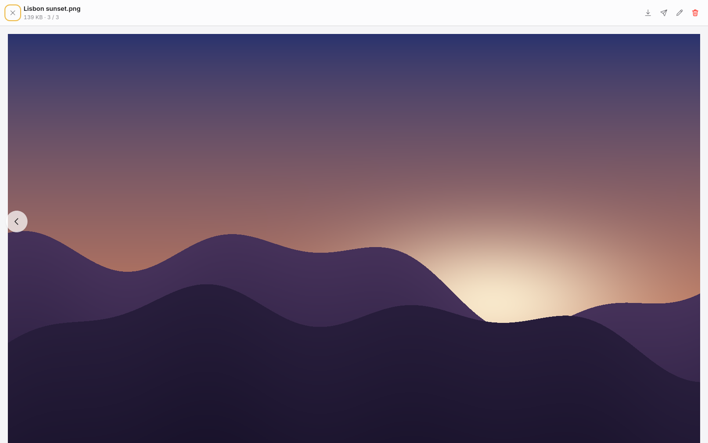
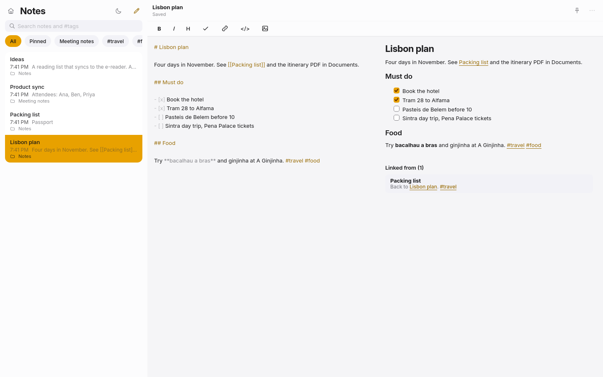
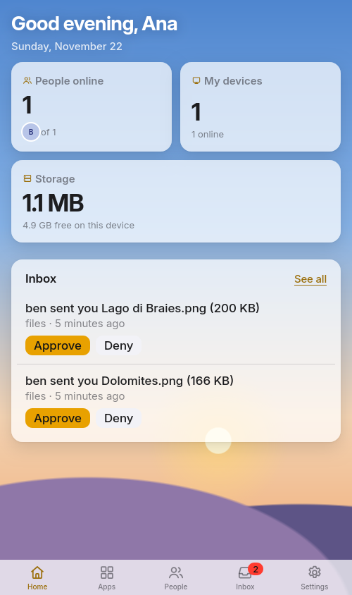
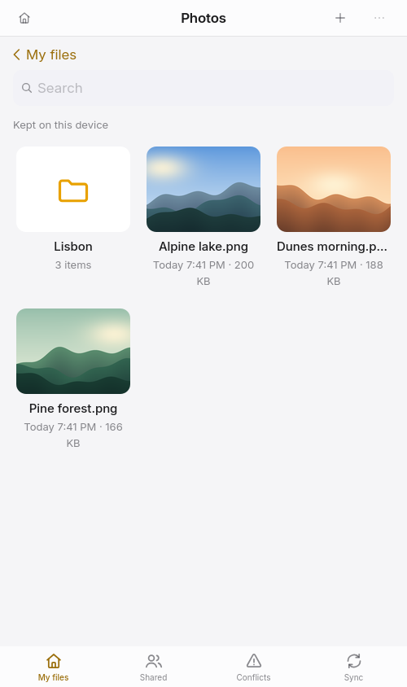
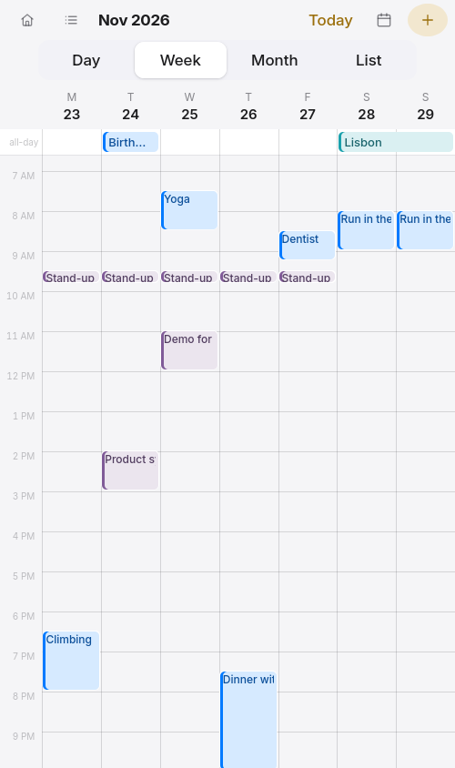
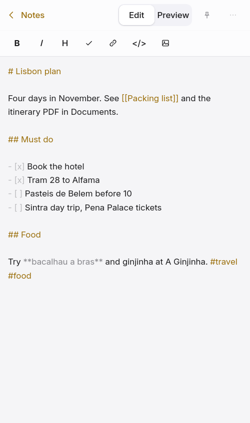
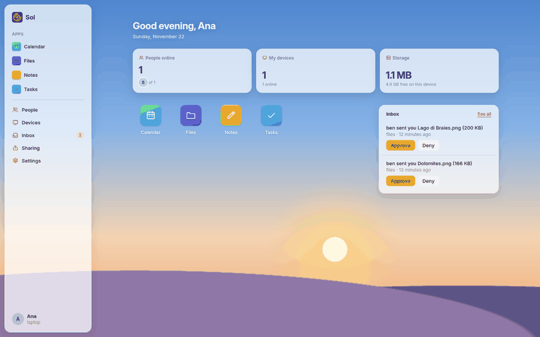

# Sol

**Your own private network of devices and people, with slim apps on top.**

Sol connects your devices and the people you add directly to each other (WireGuard, TLS or Tor,
whichever path is best), with no account and no server in the middle. On top of that one layer
run small apps that do one job each: Files, Notes, Tasks and Calendar. Every action in every app
can also be run from a script or an AI agent, with scoped keys and your approval.

<p align="center">
  
</p>

| | |
|---|---|
|  |  |
|  |  |

> **v0.2.0-beta.1 is a pre-release.** It is tested by its author on Linux, an Android emulator and
> an Android phone. There is no iOS app. macOS and Windows builds exist but are lightly tested.
> See [Status](#status-and-limitations).

## Install

### Linux and macOS

```sh
curl -fsSL https://raw.githubusercontent.com/apv022/sol-test/main/install.sh | sh
```

This downloads the `sol` binary for your machine (Tor is built in), checks it against the
release's `SHA256SUMS`, puts it in `~/.local/bin`, adds that folder to your `PATH` where needed,
and starts Sol. Open a new terminal afterwards and plain `sol` works.

The first `sol` sets everything up: it names you after your OS account, creates your synced
folder `~/SolDrive`, starts in the background and opens Sol in your browser, already signed in
(on a fresh machine you get the setup page first: Start new, Add to my Sol, or Restore).
Sol also appears in your app menu.

Options: `SOL_VERSION=<tag>`, `SOL_BIN_DIR=<dir>`, `SOL_NO_PATH=1`, `SOL_NO_START=1`,
`SOL_REPO=owner/name` (see the top of [install.sh](install.sh)). Release assets are named
`sol-<os>-<arch>` and listed in `SHA256SUMS`.

### Windows

Download `sol-windows-amd64.exe` from the [releases page](https://github.com/apv022/sol-test/releases),
rename it `sol.exe`, put it in a folder on your `PATH`, and run `sol`.

### Android

Download the APK from [apv022/solmob-test releases](https://github.com/apv022/solmob-test/releases)
and open it (allow installs from your browser or file manager when Android asks). See the
[sol-mobile README](https://github.com/apv022/sol-mobile#readme) for the first run.

## First steps

1. **Set up.** Run `sol`. Your browser opens Sol. (`sol open` opens it again later.)
2. **Add a device.** Devices, Add my device shows a QR code and a link. On the other device
   choose "Add to my Sol" (the setup page on a computer, the first screen on Android) and scan
   or paste it. Both devices are now you: files, notes, tasks and calendars sync between them.
3. **Add a person.** People, Add a person shows a QR code and a link for them to scan or open.
   Or from a terminal: `sol invite` prints a link and `sol pair <link>` accepts it. For a contact
   who should never learn your address, use `sol invite --anonymous` (Tor only, both ways).
4. **Share a folder.** In Files, share a folder with a person as read or write. It appears for
   them under Shared. Tasks lists and Calendars are shared from their own apps; invite people to
   events from the event sheet.
5. **Send a file.** In Files, open a file and choose Send to a person, like AirDrop: they get one
   approval in their Inbox, and the file is saved under `Received/<your name>/`.

## Apps

| App | What it does | Keeps data as | Import and export |
|---|---|---|---|
| **Files** | the synced folder `~/SolDrive`, shared folders, send to a person, a swipeable viewer for images, video, audio and PDF, conflict copies, three-way merge for text | plain files in a folder | it is the folder |
| **Notes** | Markdown notes with live preview, `[[wiki links]]`, backlinks, tags, fast search, checklists | `.md` files in `SolDrive/Notes` | the files are the notes |
| **Tasks** | lists, due dates, repeats, flags, subtasks, quick add ("call mom tomorrow 9am"), shared lists | synced feed (CRDT) | Markdown checklists |
| **Calendar** | day, week, month and list views, time zones, repeats, alerts, shared calendars, invites | synced feed (CRDT) | `.ics` in and out, plus a read-only `.ics` subscription file for desktop calendar apps |

<p align="center">
  
  
  
  
</p>

Each app does one thing and stands alone: removable and replaceable without touching the others.
Each can be installed as a web app (in Chrome, Edge or Brave: Install), has its own entry in the
app menu (`sol open files`), and on Android its own home-screen icon. Notifications are local
only (no push service): Inbox items show as desktop notifications (`sol notifications on|off`)
and as Android notifications with Approve and Deny.

Also built in: **port sharing.** `sol service add <name> <port> --with <person>` shares a local
port (a web app, SSH, a game server) with a person, who opens it on their own machine with
`sol tunnel open <person> <name>`.

Appearance is yours: light, dark or auto, accent colour, density, wallpaper.

<p align="center">
  
</p>

## Agents and scripts

Every user-visible operation is an action in the app's manifest, so the command line is the
agent interface (there is no separate API to learn):

```sh
sol do --help                                   # apps and how many actions each has
sol do --help tasks                             # one app's actions
sol do tasks.add --quick "Pay rent tomorrow 9am" --list Home
sol do calendar.agenda --json                   # machine-readable output
sol do files.delete --paths Old --dry-run       # say what it would do, change nothing
```

Give an agent its own key with only the powers you choose (Settings, Agents, or the terminal):

```sh
sol agent new reader --scope 'notes.read' --scope 'notes.list' --scope 'notes.search' --days 30 --out reader.key
SOL_AGENT_KEY=./reader.key sol do notes.search --query lisbon --json   # or: sol do --as-agent reader ...
sol agent list
sol agent revoke reader
```

Destructive actions (delete) and sending files to people need your approval when an agent asks:
the call waits (exit code 3) until you approve it in the Inbox (`sol inbox`, or the web UI, or
the Android notification). Agents can't approve themselves.

## Your data and recovery

- **Files** live in `~/SolDrive` on every device: a normal folder you can use with any program.
  They sync between your devices, and the folders you share sync to the people you chose.
- **Back up your 24 words** (Settings, Backup words). They are your identity. On a fresh machine
  `sol restore --words "..."` (install with `SOL_NO_START=1` first), the setup page's "Restore
  from backup words", or the same choice on Android brings back who you are, and your contacts
  keep trusting you.
- The words restore your identity, **not your files**: files come back by syncing from any device
  of yours that is still around. If every device that held a file is gone, so is the file. Keep
  one device that is always on (a home server, a NAS, an old laptop) so there is always a copy.
- `sol reset --confirm <name>` removes Sol from this machine (identity archived, folder kept).

## Privacy model

- **No servers, no accounts.** Nothing of Sol's runs in the middle. Devices find each other with
  keys, introductions through your own devices and contacts, and Tor.
- **No relays of strangers' traffic.** Sol does not route anyone else's packets and nobody
  routes yours. Two devices that can't reach each other directly fall back to Tor.
- **Strangers get nothing.** A connection from someone who isn't you or a contact is closed
  without a byte of reply.
- **Anonymous contacts** talk to you over Tor only, in both directions, and never learn an
  address of yours (`sol people set <name> --anonymous`).
- Direct paths (WireGuard, TLS) show a contact your IP address; Tor hides it and is slower. Sol
  picks the best path that your privacy settings allow.
- Secrets (keys, tokens, pairing secrets) are never logged; secret files are `0600`.

Details: [design/IDENTITY.md](design/IDENTITY.md), [design/PROTOCOL.md](design/PROTOCOL.md),
[design/SECURITY_REVIEW.md](design/SECURITY_REVIEW.md). There has been no independent security
review yet.

## Everyday commands

```sh
sol                 # start Sol in the background (sets it up on first run) and return
sol open [app]      # open Sol, or one app (sol open files), in the browser
sol status          # this device, your people, connections
sol stop            # stop it;  sol restart;  sol logs -f
sol version         # this binary's version (and the running Sol's, if different)
sol autostart on    # start Sol when you log in
sol people          # your contacts
sol do --help       # every app action
sol --help          # everything else
```

## Status and limitations

v0.2.0-beta.1 is a rebuild of Sol: the earlier alpha (a Tor-only proof of concept) is replaced
and is not compatible. Known limits:

- Tested by the author on Linux and on an Android emulator and phone. No iOS. macOS and Windows
  builds exist and pass the test suite but are lightly used.
- No independent security review yet.
- Android: arm64 APK from GitHub only, not on Google Play or F-Droid; notifications are local, so
  they arrive while the Sol node is running.
- First contact over Tor can take a while.
- Planned, not built: Music, Movies, Chat and an agent app (see [design/PLAN.md](design/PLAN.md)).

Changes are listed in [CHANGELOG.md](CHANGELOG.md).

## For developers

Read [AGENTS.md](AGENTS.md), then [design/VISION.md](design/VISION.md) (why),
[design/ARCHITECTURE.md](design/ARCHITECTURE.md) (how), [design/API.md](design/API.md) (the app
contract) and [design/PLAN.md](design/PLAN.md) (what is done). Go only, no third-party
dependencies except `wireguard-go`; UIs are plain JS modules with no build step.

```sh
make build          # bin/sol
make check          # gofmt + go vet + tests with -race
make browser-test   # browser suites in headless Firefox
android/build.sh    # the Android app (see android/README.md)
```
