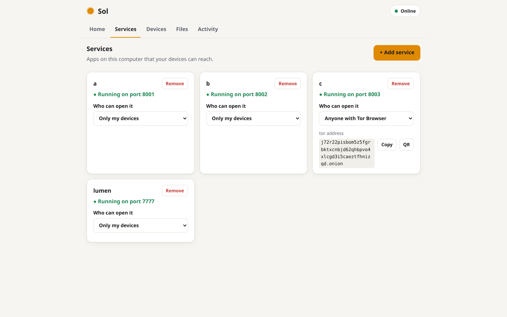
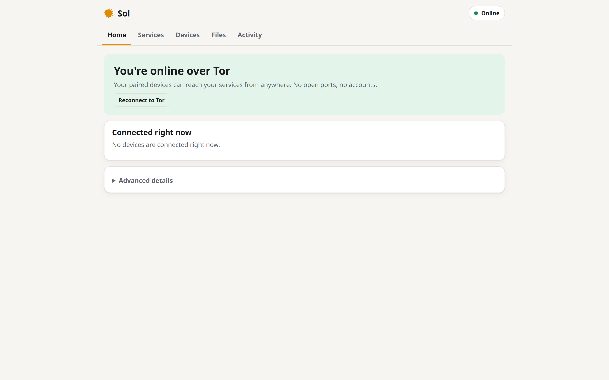
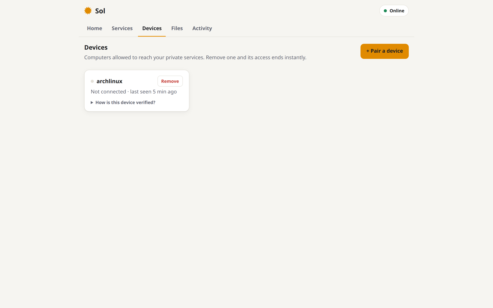
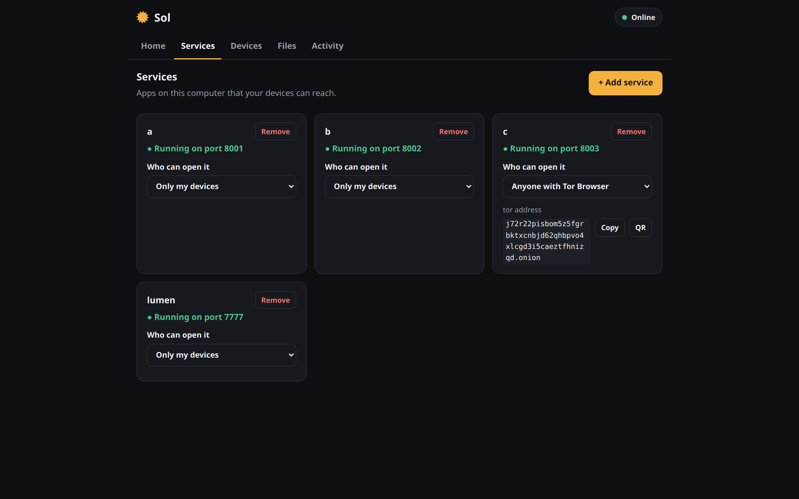

# Sol

**Self-host anything, reach it from anywhere, over Tor.**
No port forwarding, no VPN, no accounts, no domain, no cloud.

[](https://github.com/apv022/sol/actions/workflows/ci.yml)
[](LICENSE)


```
home machine (behind CGNAT, no open ports)          your laptop, anywhere
┌──────────────────────────────────────┐            ┌──────────────────────────┐
│ Navidrome :4533 ─┐                   │    Tor     │ sol connect              │
│ Jellyfin  :8096 ─┼─ sol ─ tor ───────┼────────────┼─ localhost:9000 → music  │
│ sshd      :22   ─┘   (outbound only) │            │ localhost:9001 → movies  │
└──────────────────────────────────────┘            └──────────────────────────┘
```

Sol is one Go binary. Point it at apps running on your machine, pair your devices with a one-time
link or QR code, and every paired device can reach them through Tor. Nobody else can even find
them.

<!-- demo GIF: record with `vhs docs/demo.tape` and replace this comment -->

<p align="center"></p>

## Why

Self-hosting usually means fighting your router, CGNAT, dynamic DNS, TLS certificates, and VPN
configs, or handing your traffic to a tunnel company. Sol skips all of it:

- **Zero network config.** Sol only makes outbound connections. It works behind CGNAT, on hotel
  Wi-Fi, and on mobile hotspots.
- **Private by default.** A service is invisible to anyone you haven't paired: Tor client
  authorization hides the address, and the handshake drops strangers without a single byte of reply.
- **Per-device access.** One link per device. Revoke a lost phone and its connections close
  instantly.
- **Any TCP service.** HTTP, WebSockets, media streaming with seeking, SSH, game servers, databases.
- **Public too, if you want.** Flip a service to `public` and it gets its own `.onion` that anyone
  can open in Tor Browser. It can't be linked to your private node.
- **Small and auditable.** Standard-library Go, zero third-party Go dependencies, no build step for
  the UI.

## Quick start

You need `tor` installed on both machines (`sudo apt install tor`, `brew install tor`, …) and Go
1.24+ to build.

```sh
go install github.com/apv022/sol/cmd/sol@latest
```

**On the machine with your services:**

```sh
sol                       # starts the node; panel at http://127.0.0.1:8080
```

In the panel, **Services → Add**: name `navidrome`, port `4533`, private. Then **Devices → Pair a
device** gives you a link and a QR code.

**On your laptop:**

```sh
sol connect 'sol://pair?v=1&node=…'    # first time: pairs, then opens tunnels
#   navidrome -> http://127.0.0.1:9000
```

Open `http://127.0.0.1:9000`. Next time, just run `sol connect`.

The panel walks you through it: a getting-started checklist, presets for common apps (Navidrome,
Jellyfin, Immich, Home Assistant, SSH…), a warning if the app isn't running, and a live view of
which devices are connected to what, each one cryptographically verified.

> Tor is slow to start the first time (around 30 s to bootstrap, plus up to a minute for a new
> onion to become reachable). After that, connections are quick.

Try it without Tor on one machine: set `"clearnet": true` in `~/.sol/config.json`. That's for LAN
and testing only, since clearnet traffic is not encrypted.

## How it works

1. The node runs its own `tor` child process and publishes one **private onion** for itself,
   locked with Tor v3 client authorization.
2. Pairing gives a device two keys: an **ed25519** device key (generated on the device) and an
   **x25519** Tor client-auth key (in the link). The link is single use and expires in 10 minutes.
3. Every connection begins with a **signed challenge-response handshake**: the node sends a fresh
   nonce, the device signs it along with the service name, and the node checks the key is paired.
   Then the connection becomes a plain byte pipe to `127.0.0.1:<port>`.
4. **Revoking** a device closes its live connections and republishes the onion without its key.

Details: [docs/PROTOCOL.md](docs/PROTOCOL.md) · [docs/ARCHITECTURE.md](docs/ARCHITECTURE.md) ·
[docs/THREAT_MODEL.md](docs/THREAT_MODEL.md)

## Built with Sol: Lumen

[**Lumen**](https://github.com/apv022/lumen) is a personal AI agent that runs on your computer and
is reached through Sol, from a laptop with `sol connect` or a phone. It's a good example of putting
any app behind Sol: add one service and you have private, password-protected access from anywhere.

| Panel home | Devices | Services (dark) |
|---|---|---|
|  |  |  |

## Commands

| Command | What it does |
|---|---|
| `sol` | Run a node (panel on `127.0.0.1:8080`, data in `~/.sol`) |
| `sol pair <link> [--name N]` | Pair this device with a node |
| `sol connect [link] [-L svc=127.0.0.1:PORT]` | Open local tunnels (default: every service on 9000, 9001, …) |
| `sol audit` | Leak checks for anonymous-public services |
| `sol version` | Print the version |

Environment variables: `SOL_DATA` (node dir), `SOL_CLIENT_DIR` (client dir), `SOL_DEBUG=1`.

## Status

Sol is **early**. It works and is tested, but it hasn't had an independent security review.

| Feature | Status |
|---|---|
| Tor onion services with client authorization | ✅ |
| Signed handshake, per-device pairing and instant revocation | ✅ |
| Any TCP service, tunnels with `sol connect` | ✅ |
| Web panel: guided setup, pairing wizard, live "connected and verified" status per device | ✅ |
| Public services on their own onion | ✅ |
| Shared files: browsable page for paired devices, streaming, SHA-256 verified | ✅ |
| LAN / clearnet transport (testing) | ✅ |
| Release builds with tor bundled | 🚧 (`make build-bundled`, per platform) |
| Anonymous Public Mode (egress lock, EXIF stripping, full audit) | 🚧 partial. See the [threat model](docs/THREAT_MODEL.md) |
| I2P transport | 🗺️ stub in place ([how to add it](docs/EXTENDING.md)) |
| Gateway: open services in a normal phone browser | 🗺️ v0.2 |
| Known-hosts directory | 🗺️ |

The full roadmap is in [docs/spec.md §12](docs/spec.md#12-roadmap).

## How Sol compares

| | Sol | Tailscale | Cloudflare Tunnel / ngrok | Hand-made Tor onion |
|---|---|---|---|---|
| Account needed | No | Yes | Yes | No |
| Third party sees your traffic | No (Tor, end to end) | No (WireGuard) | Yes (TLS terminates at the provider) | No |
| Works behind CGNAT | Yes | Yes | Yes | Yes |
| Hides your IP from clients | Yes | No | From clients, not the provider | Yes |
| Per-device access and revocation | Yes, built in | Yes | Via provider ACLs | Manual key files |
| Speed | Tor speed (fine for media, not for 4K) | Fast | Fast | Tor speed |
| Setup | One binary, a link | App + login | Account + domain | torrc, keys, restarts |

Pick Sol when you want privacy and independence more than raw speed.

## Development

```sh
make test      # unit tests + full node/client e2e over clearnet (no Tor needed)
make check     # gofmt, vet, staticcheck, tests (what CI runs)
make test-tor  # e2e over the real Tor network (needs tor; takes a few minutes)
```

Start with [AGENTS.md](AGENTS.md) for a map of the code and the rules, and
[docs/EXTENDING.md](docs/EXTENDING.md) to add a transport, provider, or audit check. See
[CONTRIBUTING.md](CONTRIBUTING.md) for how to contribute.

## License

[Apache-2.0](LICENSE). The vendored QR library in `web/vendor/` is MIT.
