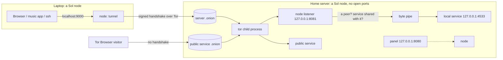

# Architecture

How the code is organised and how a request flows through it. For *why* Sol exists and where it
is going, see [spec.md](spec.md). For the peer model, see [PEERS.md](PEERS.md). For the wire
format, see [PROTOCOL.md](PROTOCOL.md).

## The big picture



The arrow works the other way too: the server can open the laptop's shared services or send it
files, because the laptop publishes its own onion.

- **One binary, one role.** Every machine runs `sol` (a node). Nodes pair with each other as
  peers. Other `sol` commands talk to the local node over `control.sock`.
- **Outbound only.** Tor (and later I2P) makes outbound connections to its network, and onion
  services need no inbound port.
- **Private services** are reached through the node's own onion plus a signed handshake, and only
  by the peers they are shared with. **Public services** each get their own onion, so a public
  site can't be linked to the node.

## Packages

| Package | Job | Key types and functions |
|---|---|---|
| `cmd/sol` | CLI: starts the node in the background (`sol`), runs it (`sol run`), or sends one request to it over the control socket | `runStart`, `runNode`, `runPair`, `runOpen`, `runSend`, `runConfig` |
| `internal/node` | Composition root. Node listener, routing, peers, pairing, dialing out, inbox, tunnels, control socket, publications | `New`, `Run`, `handleConn`, `Pair`, `DialPeer`, `OpenTunnel`, `SendFile`, `Unpair`; implements `api.Backend` |
| `internal/protocol` | The handshake | `ReadRequest`, `Accept`, `ClientHandshake`, `ReadPeerInfo`, `Card` |
| `internal/peers` | Peer list with change hooks and share lists | `Peers.Add/Remove/Lookup/Find/SetShared/AccessKeys`, `Inbox`, `Files` |
| `internal/pairing` | One-time tokens and `sol://pair` links | `Manager.NewToken/Consume/Pending`, `Link`, `ParseLink` |
| `internal/identity` | ed25519 node keys, x25519 Tor client-auth keys | `LoadOrCreate`, `NodeID`, `DeviceID`, `NewX25519` |
| `internal/config` | `~/.sol/config.json`: atomic save, validation, migration | `Load`, `AddService`, `AddPeer`, `UpdatePeer`, `Snapshot` |
| `internal/transport` | `Transport` interface, `Registry`, Tor / WireGuard / TLS direct / clearnet / I2P(stub), STUN, per-peer access | `Publication`, `Access`, `AccessIssuer`, `ClientAuthorizer`, `Tor`, `WG`, `Direct`, `Clearnet` |
| `internal/runtime` | Find and run external programs (tor) | `Provider`, `Select`, `Native`, `Bundled`, `Docker`(stub) |
| `internal/snowflake` | The opt-in Snowflake proxy (`help_tor`): runs the official `snowflake-proxy` as its own process, restarts it, reports its state | `Helper.Start/Stop/Status` |
| `internal/autostart` | Start the node at login: systemd user unit (Linux), LaunchAgent (macOS) | `Manager.Enable/Disable/Status`, `SystemdUnit`, `LaunchAgentPlist` |
| `internal/control` | Control-socket wire format and client | `Request`, `Call`, `Dial`, `Path` |
| `internal/api` | Panel JSON API, loopback + CSRF guards | `Handler`, `Backend`, `PeerView` |
| `internal/blob` | Content-addressed files with range serving and sender labels | `Store.Put/PutLimited/List/Browser/Received` |
| `internal/proxy` | HTTP reverse proxy for public `http` services, header stripping | `NewServiceProxy` |
| `internal/site` | Serves a folder as a static website (`sol site add`): no listings, no dotfiles, no file dates, nothing outside the folder | `Handler` |
| `internal/record` | Signed service record: one key states which addresses are one public service | `Sign`, `Verify`, `Handler`, `Record.Reaches` |
| `internal/audit` | Leak checks for anonymous-public services | `Check`, `Checks`, `Run` |
| `internal/events` | Ring-buffer log for the panel | `Log.Add/Recent` |
| `internal/netutil` | Byte pipe, free ports, LAN IP | `Pipe`, `FreePorts`, `LANIP` |
| `internal/gateway` | v0.2 HTTPS front door (stub, design in package doc) | `Run` |
| `web` | Panel HTML/CSS/JS, embedded with `go:embed` | `FS` |
| `internal/e2e` | Several nodes in one process (clearnet), plus an opt-in real-Tor test | |

**Dependency rules:** only `node` and `cmd/sol` wire packages together. `api` reaches the node
only through the `api.Backend` interface (it uses other packages for their types). The leaf
packages `config`, `identity`, `events`, `control`, and `netutil` import no other Sol package;
`blob` builds on `config`, `peers` on `config` and `identity`, and `protocol` and `record` import
only `identity`; `site` imports nothing. Sol has **one third-party Go dependency**, the official `wireguard-go` (with the gVisor
network stack it brings) for direct mode; new ones need a good reason.

## Request paths

### Opening a peer's service (`sol open server` → Navidrome)

1. `sol open` asks the node to refresh the peer (`OpPeers` with `refresh`), which sends `list` to
   the peer and saves what it shares. It then sends `OpTunnelOpen` per service (the panel's Open
   button calls `POST /api/peers/{id}/services/{svc}/open`). `Node.OpenTunnel` (`tunnels.go`)
   listens on `127.0.0.1:9000…` and saves the tunnel in config; `startSavedTunnels` reopens it
   at the next start.
2. For each local connection (or, for `http` services, each upstream connection the tunnel's
   reverse proxy needs, after its Host check), the tunnel calls `DialPeer`.
3. The node's `DialPeer` → `dial` picks an address (the peer's direct address unless it failed and
   hasn't proved stable since, then the last one that worked, then ready transports, then Tor before I2P
   before clearnet), dials it (`transport.Tor.Dial` → SOCKS5 →
   `<peer>.onion:80`), and runs the handshake, checking the callee is the expected node.
4. On the peer, Tor forwards to the node listener `127.0.0.1:8081`, and `node.handleConn` →
   `protocol.ReadRequest` verifies the signature.
5. `handleConnect` checks the key is a peer and the service is in its `Shares`, dials
   `127.0.0.1:4533`, sends OK, registers the stream, and calls `netutil.Pipe`.

Both nodes track the stream (`connInfo{peer, service, outbound}`), so either side's panel shows it
and removing the peer on either side closes it.

### Pairing

1. A: `Node.Invite` → `issueAccess` (one `transport.Access` per access-capable transport) →
   `pairing.NewToken(access)`. `refreshNodePublication` republishes A's onion with the token's
   key authorized. The `sol://pair` link carries A's addresses and the secret halves.
2. B: `Node.Pair(link)` installs A's access (`ClientAuthorizer`), issues its own access for A,
   publishes its onion with that key authorized right away (`Node.joining`, so the new descriptor
   spreads while the pairing dial runs), and sends `OpPair` with the secret and a signed card
   `{name, addrs, access}`.
3. A: `handlePair` burns the token, saves B (`AccessIn` from the token, `Addrs`/`AccessOut` from
   the card), installs B's access, and replies with `PeerInfo`. It then asks B what it shares
   (`learnShares`), retrying while B saves the pairing.
4. B saves A. Saving fires `OnChange`; A's key is already published (step 2), so B's onion is not
   re-published again. If pairing fails, the key is withdrawn.

### Sending a file (`sol send server notes.pdf`)

`sol send` streams the file into `control.sock` (`OpSend`). The node's `SendFile` dials the peer's
`_inbox`, `PUT`s the file over HTTP while hashing it, and checks the peer's answer matches. On the
peer, `inboxHandler` (one HTTP server per verified stream, so it knows the sender) enforces the
per-file and total limits and stores it with `blob.PutLimited`, labelled with the sender.

### Peer liveness and fallback (`internal/node/liveness.go`)

A supervisor goroutine, started by `Run`, keeps peer paths honest (protocol side: PROTOCOL.md,
"Liveness"). It probes every address that carries a live outbound stream (`connInfo.addr`) with
a `list` request; after `Liveness.Misses` failures it closes those streams, marks a direct path
failed (`directFail`, `dial.go`) and redials over the next path. Redials of unreachable peers
back off with jitter, at most `maxProbes` run at once and one per peer. A failed direct path is
demoted in `addrsInOrder` until background probes have succeeded `DirectStableProbes` times over
`DirectStableFor` (hysteresis); a failure meanwhile doubles its backoff. `Node.NetworkChanged`
forwards to transports implementing `transport.NetworkWatcher` (Tor restarts, WireGuard
re-learns its address and punches again) and also kicks the supervisor, as does a wall-clock
jump ahead of the monotonic clock (resume from sleep). All timings are in `node.Options.Liveness`
so tests run them in milliseconds.

What the panel should show about a path comes from `Node.PeerLink(id) (PeerLink, bool)`:
`Via` and `Live` (the newest live outbound stream's transport, else the last dial or probe that
worked), `LastOK`, `Down`/`DownSince`/`NextRedial`/`LastError` (the peer couldn't be reached),
`Fallback`/`FallbackAt` (why the last connection didn't go direct; cleared when one does), and
`Direct["wg"|"direct"]` (`State` "backoff" or "probation", `FailedAt`, `Failures`, `LastError`,
`NextProbe`, `PreferredAt`). A direct path that isn't in `Direct` is preferred.

### Live status in the panel

`Node.Peers()` groups tracked streams into `api.PeerView.Connections` (inbound and outbound), so
the panel can show a peer as "connected and verified". Every listed stream passed the handshake
with that peer's key. `Node.Services()` probes each service's local port, so the panel can warn
when the app isn't running. Files keep a name and sender in `blobs/.names.json`. The built-in
`_files` service is `blob.Store.Browser()`, which lists and serves only the owner's own files. Blobs
are served with `Content-Security-Policy: sandbox`, so an HTML file can't run scripts.

### Starting, stopping, settings

`sol` (`runStart` in `cmd/sol/daemon.go`) starts `sol run` as a detached process whose output
goes to `sol.log` in the data directory, waits until the control socket answers, and returns.
`sol stop` and `sol restart` are control ops. On a restart `Node.Run` returns `node.ErrRestart`:
a node kept by systemd or launchd exits non-zero and is started again by it, any other node
starts its replacement before it exits.

`sol network-changed [reason]` is the control op `network-changed`: it calls `Node.NetworkChanged`
(transports that watch the network restart or re-probe, and the peer supervisor re-checks every
path). The reason is free text, control characters dropped and capped at `control.MaxReasonLen`,
default "requested". The Android app runs it whenever the default network changes.

Settings a user may change are one list, `config.Options` (`internal/config/options.go`): key,
label, help text, current value, and whether a restart is needed. `sol config` and the panel's
Settings screen (`GET /api/settings`, `PUT /api/settings/{key}`) both go through
`Node.SetOption`, which validates the whole config and rolls back on any error. A new setting is
one entry in that list. Secrets never appear in it.

`SetOption` also refuses settings that leave the node unusable (`settingProblemsLocked`): turning
off the last enabled transport, a direct or LAN address without a valid port (1 to 65535), and a
port used twice among the panel, node, direct, LAN, service and tunnel ports. It refuses only
problems the change introduces, so a config that already has one can be repaired. `CheckOption`
runs the same checks without saving.

Most settings apply at the next start, so `GET /api/settings` returns each one with `running`
(the value the node started with, remembered by the panel handler) and `pending`;
`restart_needed` in `/api/status` is true exactly while one is pending, and changing a setting
back clears it. Before the panel changes a setting it asks
`GET /api/settings/{key}/impact?value=` (`Node.OptionImpact`, `views.go`), which changes nothing
and returns plain sentences (`effects`), whether it needs a restart, whether to ask first
(`confirm`: it exposes an address, drops encryption or cuts peers off), and the peers that would
become unreachable (`unreachable`, worked out from each peer's addresses and the transports left
on). The panel confirms when needed and re-reads everything after saving.

### Which path a connection takes

`api.PeerView.Path` (`Node.peerPath`, `views.go`) says which transport carries this node's
connections to a peer (`via`, `live`), which one the next dial tries first (`next`), and, when it
isn't WireGuard, a stable `reason` code with a sentence (`detail`) and what to do (`fix`):
`direct_off`, `direct_restart`, `direct_failed`, `peer_no_direct`, `direct_backoff` (with
`retry_in`: seconds to the next background probe), `direct_probation` (with `retry_in`: seconds
until direct is preferred again), `direct_next` or `wg_blocked`. While the last attempt to reach
the peer failed, `down` is true and `redial_in` is the seconds to the next redial. It reads
`Node.PeerLink` (the liveness supervisor's state), the last good address and the running
transports. `/api/status` passes each transport's
`transport.Status` through unchanged, including Tor's start-up `phase`, `progress`,
`waiting_for`, `phase_since`, `attempt`, `retry_at`, `problem` and `restarts`, which the panel
shows instead of a spinner.

### The panel's look

The panel is one page of plain HTML, CSS and JS (`web/`), installable as an app window from
browsers that support it (`manifest.json`). Its look is separate from its logic: `style.css`
defines every colour, the font and the text size as tokens (between the `sol:tokens` comments,
which the shared files page inlines), the Appearance dialog switches theme, accent colour,
layout (tabs on top or a sidebar) and text size per browser (`localStorage`), and
`GET /user.css` serves `panel.css` from the data directory after the built-in styles, under the
same CSP. Below 760 px wide the panel switches to a top bar, a bottom tab bar and dialogs as
bottom sheets, with safe-area insets.

The same page is the whole UI of the Android app, a WebView whose user agent contains
`SolAndroid/<version>`: the panel then hides desktop-only hints and doesn't open tabs. Downloads
stay plain `<a href="/blob/…" download>` links. The app opens a `sol://pair…` link by loading
`/#pair=<url-encoded link>`; the panel treats it as untrusted (prefix and length checked), puts
it in the join form and waits for the user to press Pair, then clears the hash.

### Removal

Panel `DELETE /api/peers/{id}` or `sol unpair` → `Node.Unpair` tells the peer (`unpair` op, best
effort), then `Peers.Remove` → its hooks fire:
- `OnRemove`: the node closes every live stream with that peer, both directions, and forgets the
  peer's access key in its own tor.
- `OnChange`: `refreshNodePublication` republishes the onion without the peer's key.

A peer receiving `unpair` runs the same removal.

### Public service

`Node.publishService` publishes `svc-<name>` on each allowed transport, targeting the service
directly (`tcp`) or a local `proxy` instance (`http`, with header stripping for
anonymous-public). Anonymous-public services are never published on clearnet.

### Sites and signed records

A **site** is a service with a folder (`dir`) instead of a port (`sol site add`). The node serves
the folder itself with `site.Handler` (`node/sites.go`): a public site on its publication's own
listener, a private one over each peer's verified stream (`serveHTTPConn`), so a private site
never sits on a loopback port.

A public `http` service or site with `record: true` also answers `/.well-known/sol.json` with a
**signed service record** (`internal/record`): the service's name, its addresses on every
transport, and the ed25519 key that signed them. The key is the service's own
(`services/<name>.key`), never the node key. A verifier fetches the record from an address and
checks that the record names that address, which proves the key and the address agree. This is
what a directory or a discovery channel will carry. It is opt-in because it shows the site runs
Sol.

## Runtime and Tor

- `runtime.Select(order, "tor")` tries `bundled` (only in `-tags bundled` builds, checksum
  pinned), then `native` (`tor` on PATH), then `docker` (stub).
- `transport.Tor` writes a torrc with random free SOCKS and control ports, cookie auth, and
  `__OwningControllerProcess`. It authenticates, sends `TAKEOWNERSHIP` (so tor dies with Sol),
  polls bootstrap progress, and restarts tor with backoff if it exits, re-registering every onion
  and client key.
- **Supervisor** (`transport/tor.go`, `supervise` + `monitor`): one goroutine owns the tor process
  and never gives up, so nobody has to press Reconnect. It replaces tor when the process exits or
  cannot start (backoff `torRetryBase` doubling to `torRetryMax`; a requested restart or a network
  change cuts it short), when the control port drops or stops answering (every control command
  has a deadline), when bootstrap makes no progress for `bootstrapStall` while the machine has a
  route (`netutil.Online`; without one the phase is `offline` and nothing is restarted), and
  after `purgeAfterStalls` stalls in a row it deletes the cached directory files first (never
  `state` or keys). Publications and client keys given while tor is down are remembered and
  registered by the next tor. Phases: `launching` → `bootstrapping` → `publishing` (connected,
  address not yet announced) → `ready`, plus `offline` and `retrying`. `transport.Status` reports
  them for the UI: `phase`, `progress` (bootstrap %), `waiting_for`, `phase_since`, `attempt` (1 =
  first try since tor last worked), `retry_at` (while retrying), `problem` (why the last attempt
  was given up) and `restarts`. `Tor.NetworkChanged(reason)`, reached through
  `Node.NetworkChanged` for every `transport.NetworkWatcher` (the hook a mobile OS calls), is
  debounced by `netLoop`: one restart per burst (`netSettle`, at most `netSettleMax`), at most one
  per `netRestartGap`, none while offline or for a tor started after the change, and only a kick
  of the backoff while retrying. Stop waits for every supervisor goroutine. The tests drive all of
  this against `faultnet`'s scripted fake tor with shortened timings
  (`transport/torsupervisor_test.go`).
- Onion keys live in `~/.sol/tor/onions/<publication id>.key`, so addresses survive restarts. Tor's
  own state (`tor/data`) is kept too, so later starts bootstrap in seconds.
- **Health** (`transport/torhealth.go`): tor doesn't notice network changes such as a VPN turning
  on, and keeps saying "bootstrapped" while its onions are dead. So `watchNetwork` reports a change
  of local IP addresses (and tor's `CLOCK_JUMPED`, a wake from sleep) to `NetworkChanged`, and `selfCheck` dials our own onion through our own tor. Onions
  with client auth also authorize a private "self" key for this. `Status` reports `ready` once
  tor says a directory accepted our descriptor (an `HS_DESC UPLOADED` event, read on a second
  control connection) or a self-check succeeds. The upload event comes first, usually within ten
  seconds; the self-check alone could take minutes, because it asks one random directory and a
  slow one stalls it. Two failed self-checks in a row mark the node unreachable, and four restart
  tor (at most every 10 minutes).
  The node drops the probe's empty connection silently (`protocol.ErrNoData`).
- **Reaching an onion** (`transport/tordial.go`): tor first fetches the onion's descriptor from
  one directory. Measured, that answers in 3 to 5 s or hangs until `SocksTimeout` (120 s by
  default), and more SOCKS requests only join the hung fetch. So `Tor.Dial` sends `HSFETCH`
  when no `HS_DESC RECEIVED` for that address arrived within `hsFetchAfter` (8 s; then every
  10 s, at most 3): tor asks another directory and the first descriptor serves the waiting
  connection. The torrc sets `SocksTimeout 45` (a whole first contact took 9 to 14 s), and
  `ExtendedErrors`, so a failure says why (descriptor not found, introduction failed, ...).
  The node retries a failed dial after 5 s (`Options.DialRetryDelay`), 6 attempts.

### Helping the Tor network

Sol only uses Tor: its tor is a client and an onion-service host, never a relay. A relay needs an
open port, and its public IP and uptime could be matched against this node's onions. The way to
give back is `help_tor` (`sol snowflake on`, or the panel): the node runs the official
`snowflake-proxy` as a separate process, found through `runtime.Select` like tor, capped at 10
users at a time. It lets people in censored countries reach Tor through this machine, needs no
open port, and shares nothing with the node's own tor. It is off by default because it contacts
the Tor Project's broker and relay and public STUN servers from this machine's IP.

## On disk

```
~/.sol/
├── node.key                ed25519 seed (0600). Back this up: it is the node's identity
├── wg.key                  WireGuard key for direct mode (0600; replaced freely, peers relearn it)
├── config.json             name, services, peers (incl. access keys), tunnels, ports, transports (0600, atomic)
├── control.sock            local CLI socket (0600; only while the node runs)
├── sol.log                 what a node started with `sol` logged (moved to sol.log.1 at 5 MB)
├── autostart-unit          where `sol autostart on` wrote the systemd unit (Linux, if enabled)
├── services/<name>.key     ed25519 seed that signs one public service's record (0600)
├── panel.css               optional: your own styles for the panel, loaded after the built-in ones
├── blobs/<sha256>          (+ .names.json: display name and sender per file)
├── bin/                    extracted bundled binaries
├── snowflake/              snowflake-proxy.log (only if "help the Tor network" is on)
└── tor/                    torrc, tor.log, data/, onions/<id>.key
```

## Invariants (do not break these)

1. The panel binds loopback only and checks the Host header and CSRF token. It is never published.
   The control socket is a `0600` Unix socket in the `0700` data directory, never on the network.
2. Rejections on the node listener send **no bytes**. Use `node.reject`, never an error page.
3. Nothing logs secrets, pairing tokens, keys, or request bodies. Peer access keys never leave the
   node: `api.PeerView` and `control.PeerView` have no credential fields.
4. Key and config files are `0600`, data directories `0700`. Config writes are atomic.
5. Anonymous-public services are never published on clearnet.
6. A peer reaches only what is in its `Shares`; new peers get `_inbox` only.
7. Every new transport, provider, or audit check plugs into its interface. See [EXTENDING.md](EXTENDING.md).
