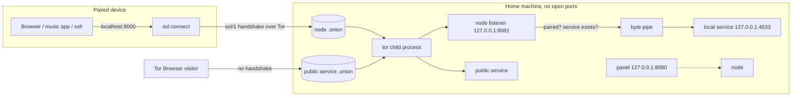

# Architecture

How the code is organised and how a request flows through it. For *why* Sol exists and where it
is going, see [spec.md](spec.md). For the wire format, see [PROTOCOL.md](PROTOCOL.md).

## The big picture



- **One binary, two roles.** `sol` runs a node. `sol pair` and `sol connect` run the client.
- **Outbound only.** Tor (and later I2P) makes outbound connections to its network, and onion
  services need no inbound port.
- **Private services** are reached through the node's own onion plus a signed handshake.
  **Public services** each get their own onion, so a public site can't be linked to the node.

## Packages

| Package | Job | Key types and functions |
|---|---|---|
| `cmd/sol` | CLI, mode switch, user-facing output | `runNode`, `runPair`, `runConnect`, `runAudit` |
| `internal/node` | Composition root. Owns the node listener, routing, revocation, publications | `New`, `Run`, `handleConn`, `refreshNodePublication`; implements `api.Backend` |
| `internal/protocol` | sol/1 handshake | `ReadRequest`, `Accept`, `ClientHandshake`, `ReadServiceList` |
| `internal/auth` | Paired-device list with change hooks | `Devices.Add/Remove/Lookup/Touch/TorAuthKeys` |
| `internal/pairing` | One-time tokens and `sol://pair` links | `Manager.NewToken/Consume/Pending`, `Link`, `ParseLink` |
| `internal/identity` | ed25519 node/device keys, x25519 Tor client-auth keys | `LoadOrCreate`, `NodeID`, `DeviceID`, `NewX25519` |
| `internal/config` | `~/.sol/config.json`: atomic save, validation, migration | `Load`, `AddService`, `AddDevice`, `Snapshot` |
| `internal/transport` | `Transport` interface, `Registry`, Tor / clearnet / I2P(stub) | `Publication`, `Tor`, `Clearnet`, `ClientAuthorizer` |
| `internal/runtime` | Find and run external programs (tor) | `Provider`, `Select`, `Native`, `Bundled`, `Docker`(stub) |
| `internal/connect` | Client: pair, remember nodes, tunnels | `Pair`, `Load`, `Client.Dial`, `Client.Listen` |
| `internal/api` | Panel JSON API, loopback + CSRF guards | `Handler`, `Backend` |
| `internal/blob` | Content-addressed files with range serving | `Store.Put/Open/List/Handler` |
| `internal/proxy` | HTTP reverse proxy for public `http` services, header stripping | `NewServiceProxy` |
| `internal/audit` | Leak checks for anonymous-public services | `Check`, `Checks`, `Run` |
| `internal/events` | Ring-buffer log for the panel | `Log.Add/Recent` |
| `internal/netutil` | Byte pipe, free ports, LAN IP | `Pipe`, `FreePorts`, `LANIP` |
| `internal/gateway` | v0.2 HTTPS front door (stub, design in package doc) | `Run` |
| `web` | Panel HTML/CSS/JS, embedded with `go:embed` | `FS` |
| `internal/e2e` | Node + client in one process (clearnet), plus an opt-in real-Tor test | |

**Dependency rules:** only `node` and `cmd/sol` wire packages together. `api` reaches the node
only through the `api.Backend` interface (it uses other packages for their types). The leaf
packages `config`, `identity`, `events`, and `netutil` import no other Sol package, and
`protocol` imports only `identity`. Sol has **no third-party Go dependencies**, and new ones need
a good reason.

## Request paths

### Private service (`sol connect` → Navidrome)

1. `connect.Client.Listen` accepts a local connection on `127.0.0.1:9000`.
2. `Client.Dial` picks an address (last one that worked, then ready transports first) and dials it:
   `transport.Tor.Dial` → SOCKS5 → `<node>.onion:80`.
3. Tor on the node forwards to the node listener `127.0.0.1:8081` (`ADD_ONION Port=80,127.0.0.1:8081`).
4. `node.handleConn` → `protocol.ReadRequest` verifies the signature.
5. `handleConnect` checks `devices.Lookup(key)` and the service, dials `127.0.0.1:4533`, sends OK,
   registers the connection under the device ID, and calls `netutil.Pipe`.

### Pairing

1. Panel `POST /api/devices/pair` → `Node.NewPairing` → `pairing.NewToken(withTor)` creates a secret
   and an x25519 key. `refreshNodePublication` re-publishes the node onion with that key authorized.
2. The panel shows the `sol://pair` link and a QR code.
3. `sol pair <link>` → `connect.Pair` installs the Tor client key, dials, and sends an `OpPair`
   handshake with the secret.
4. `node.handlePair` → `pairing.Consume` (burns the token) → `devices.Add` with the token's Tor
   public key → replies with the service list. The key set is unchanged (it moved from "pending"
   to "device"), so the onion is not republished.

### Live status in the panel

`node.handleConnect` records every open stream as `connInfo{device, service, since}`.
`Node.Devices()` groups them into `api.DeviceView.Connections`, so the panel can show a device as
"connected and verified". Every listed stream passed the sol/1 handshake signed by that device's
paired key. The first stream of a device to a service also logs a `connect` event.
`Node.Services()` probes each service's local port, so the panel can warn when the app isn't
running. Uploaded files keep a display name in `blobs/.names.json`. Content is still addressed
only by hash.

### Revocation

Panel `DELETE /api/devices/{id}` → `Devices.Remove` → its hooks fire:
- `OnRemove`: the node closes every live connection of that device.
- `OnChange`: `refreshNodePublication` republishes the onion without the device's Tor key.

### Public service

`Node.publishService` publishes `svc-<name>` on each allowed transport, targeting the service
directly (`tcp`) or a local `proxy` instance (`http`, with header stripping for
anonymous-public). Anonymous-public services are never published on clearnet.

## Runtime and Tor

- `runtime.Select(order, "tor")` tries `bundled` (only in `-tags bundled` builds, checksum
  pinned), then `native` (`tor` on PATH), then `docker` (stub).
- `transport.Tor` writes a torrc with random free SOCKS and control ports, cookie auth, and
  `__OwningControllerProcess`. It authenticates, sends `TAKEOWNERSHIP` (so tor dies with Sol),
  polls bootstrap progress, and restarts tor with backoff if it exits, re-registering every onion
  and client key.
- Onion keys live in `~/.sol/tor/onions/<publication id>.key`, so addresses survive restarts.
- **Health** (`transport/torhealth.go`): tor doesn't notice network changes such as a VPN turning
  on, and keeps saying "bootstrapped" while its onions are dead. So `watchNetwork` restarts tor
  when local IP addresses change, and `selfCheck` dials our own onion through our own tor. Onions
  with client auth also authorize a private "self" key for this. `Status` reports `ready` only
  after a self-check succeeds, and repeated failures restart tor (at most every 10 minutes).
  The node drops the probe's empty connection silently (`protocol.ErrNoData`).

## On disk

```
~/.sol/                     node
├── node.key                ed25519 seed (0600). Back this up: it is the node's identity
├── config.json             services, devices, ports, transports (0600, atomic writes)
├── blobs/<sha256>         (+ .names.json: display names for uploads)
├── bin/                    extracted bundled binaries
└── tor/                    torrc, tor.log, data/, onions/<id>.key

~/.sol-client/              client
├── device.key
├── nodes.json              paired nodes: addresses, Tor client key, services
└── tor/
```

## Invariants (do not break these)

1. The panel binds loopback only and checks the Host header and CSRF token. It is never published.
2. Rejections on the node listener send **no bytes**. Use `node.reject`, never an error page.
3. Nothing logs secrets, pairing tokens, keys, or request bodies.
4. Key and config files are `0600`, data directories `0700`. Config writes are atomic.
5. Anonymous-public services are never published on clearnet.
6. Every new transport, provider, or audit check plugs into its interface. See [EXTENDING.md](EXTENDING.md).
