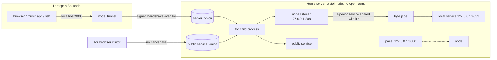

# Architecture

How the code is organised and how a request flows through it. For *why* Sol exists and where it
is going, see [spec.md](spec.md). For the peer model, see [PEERS.md](PEERS.md). For the wire
format, see [PROTOCOL.md](PROTOCOL.md).

## The big picture



The arrow works the other way too: the server can open the laptop's shared services or send it
files, because the laptop publishes its own onion.

- **One binary, one role.** Every machine runs `sol` (a node). Nodes pair with each other as
  peers. Other `sol` commands talk to the local node over `control.sock`.
- **Outbound only.** Tor (and later I2P) makes outbound connections to its network, and onion
  services need no inbound port.
- **Private services** are reached through the node's own onion plus a signed handshake, and only
  by the peers they are shared with. **Public services** each get their own onion, so a public
  site can't be linked to the node.

## Packages

| Package | Job | Key types and functions |
|---|---|---|
| `cmd/sol` | CLI: runs the node, or sends one request to it over the control socket | `runNode`, `runPair`, `runOpen`, `runSend`, `runTunnels` |
| `internal/node` | Composition root. Node listener, routing, peers, pairing, dialing out, inbox, tunnels, control socket, publications | `New`, `Run`, `handleConn`, `Pair`, `DialPeer`, `OpenTunnel`, `SendFile`, `Unpair`; implements `api.Backend` |
| `internal/protocol` | The handshake | `ReadRequest`, `Accept`, `ClientHandshake`, `ReadPeerInfo`, `Card` |
| `internal/peers` | Peer list with change hooks and share lists | `Peers.Add/Remove/Lookup/Find/SetShared/AccessKeys`, `Inbox`, `Files` |
| `internal/pairing` | One-time tokens and `sol://pair` links | `Manager.NewToken/Consume/Pending`, `Link`, `ParseLink` |
| `internal/identity` | ed25519 node keys, x25519 Tor client-auth keys | `LoadOrCreate`, `NodeID`, `DeviceID`, `NewX25519` |
| `internal/config` | `~/.sol/config.json`: atomic save, validation, migration | `Load`, `AddService`, `AddPeer`, `UpdatePeer`, `Snapshot` |
| `internal/transport` | `Transport` interface, `Registry`, Tor / direct / clearnet / I2P(stub), per-peer access | `Publication`, `Access`, `AccessIssuer`, `ClientAuthorizer`, `Tor`, `Direct`, `Clearnet` |
| `internal/runtime` | Find and run external programs (tor) | `Provider`, `Select`, `Native`, `Bundled`, `Docker`(stub) |
| `internal/autostart` | Start the node at login: systemd user unit (Linux), LaunchAgent (macOS) | `Manager.Enable/Disable/Status`, `SystemdUnit`, `LaunchAgentPlist` |
| `internal/control` | Control-socket wire format and client | `Request`, `Call`, `Dial`, `Path` |
| `internal/api` | Panel JSON API, loopback + CSRF guards | `Handler`, `Backend`, `PeerView` |
| `internal/blob` | Content-addressed files with range serving and sender labels | `Store.Put/PutLimited/List/Browser/Received` |
| `internal/proxy` | HTTP reverse proxy for public `http` services, header stripping | `NewServiceProxy` |
| `internal/audit` | Leak checks for anonymous-public services | `Check`, `Checks`, `Run` |
| `internal/events` | Ring-buffer log for the panel | `Log.Add/Recent` |
| `internal/netutil` | Byte pipe, free ports, LAN IP | `Pipe`, `FreePorts`, `LANIP` |
| `internal/gateway` | v0.2 HTTPS front door (stub, design in package doc) | `Run` |
| `web` | Panel HTML/CSS/JS, embedded with `go:embed` | `FS` |
| `internal/e2e` | Several nodes in one process (clearnet), plus an opt-in real-Tor test | |

**Dependency rules:** only `node` and `cmd/sol` wire packages together. `api` reaches the node
only through the `api.Backend` interface (it uses other packages for their types). The leaf
packages `config`, `identity`, `events`, `control`, and `netutil` import no other Sol package;
`blob` builds on `config`, `peers` on `config` and `identity`, and `protocol` imports only
`identity`. Sol has **no third-party Go dependencies**, and new ones need a good reason.

## Request paths

### Opening a peer's service (`sol open server` → Navidrome)

1. `sol open` asks the node to refresh the peer (`OpPeers` with `refresh`), which sends `list` to
   the peer and saves what it shares. It then sends `OpTunnelOpen` per service (the panel's Open
   button calls `POST /api/peers/{id}/services/{svc}/open`). `Node.OpenTunnel` (`tunnels.go`)
   listens on `127.0.0.1:9000…` and saves the tunnel in config; `startSavedTunnels` reopens it
   at the next start.
2. For each local connection (or, for `http` services, each upstream connection the tunnel's
   reverse proxy needs, after its Host check), the tunnel calls `DialPeer`.
3. The node's `DialPeer` → `dial` picks an address (the peer's direct address unless it failed in
   the last minute, then the last one that worked, then ready transports, then Tor before I2P
   before clearnet), dials it (`transport.Tor.Dial` → SOCKS5 →
   `<peer>.onion:80`), and runs the handshake, checking the callee is the expected node.
4. On the peer, Tor forwards to the node listener `127.0.0.1:8081`, and `node.handleConn` →
   `protocol.ReadRequest` verifies the signature.
5. `handleConnect` checks the key is a peer and the service is in its `Shares`, dials
   `127.0.0.1:4533`, sends OK, registers the stream, and calls `netutil.Pipe`.

Both nodes track the stream (`connInfo{peer, service, outbound}`), so either side's panel shows it
and removing the peer on either side closes it.

### Pairing

1. A: `Node.Invite` → `issueAccess` (one `transport.Access` per access-capable transport) →
   `pairing.NewToken(access)`. `refreshNodePublication` republishes A's onion with the token's
   key authorized. The `sol://pair` link carries A's addresses and the secret halves.
2. B: `Node.Pair(link)` installs A's access (`ClientAuthorizer`), issues its own access for A,
   and sends `OpPair` with the secret and a signed card `{name, addrs, access}`.
3. A: `handlePair` burns the token, saves B (`AccessIn` from the token, `Addrs`/`AccessOut` from
   the card), installs B's access, and replies with `PeerInfo`. It then asks B what it shares
   (`learnShares`), retrying while B saves the pairing.
4. B saves A. Saving fires `OnChange`, so B republishes its onion with A's key authorized.

### Sending a file (`sol send server notes.pdf`)

`sol send` streams the file into `control.sock` (`OpSend`). The node's `SendFile` dials the peer's
`_inbox`, `PUT`s the file over HTTP while hashing it, and checks the peer's answer matches. On the
peer, `inboxHandler` (one HTTP server per verified stream, so it knows the sender) enforces the
per-file and total limits and stores it with `blob.PutLimited`, labelled with the sender.

### Live status in the panel

`Node.Peers()` groups tracked streams into `api.PeerView.Connections` (inbound and outbound), so
the panel can show a peer as "connected and verified". Every listed stream passed the handshake
with that peer's key. `Node.Services()` probes each service's local port, so the panel can warn
when the app isn't running. Files keep a name and sender in `blobs/.names.json`. The built-in
`_files` service is `blob.Store.Browser()`, which lists and serves only the owner's own files. Blobs
are served with `Content-Security-Policy: sandbox`, so an HTML file can't run scripts.

### Removal

Panel `DELETE /api/peers/{id}` or `sol unpair` → `Node.Unpair` tells the peer (`unpair` op, best
effort), then `Peers.Remove` → its hooks fire:
- `OnRemove`: the node closes every live stream with that peer, both directions, and forgets the
  peer's access key in its own tor.
- `OnChange`: `refreshNodePublication` republishes the onion without the peer's key.

A peer receiving `unpair` runs the same removal.

### Public service

`Node.publishService` publishes `svc-<name>` on each allowed transport, targeting the service
directly (`tcp`) or a local `proxy` instance (`http`, with header stripping for
anonymous-public). Anonymous-public services are never published on clearnet.

## Runtime and Tor

- `runtime.Select(order, "tor")` tries `bundled` (only in `-tags bundled` builds, checksum
  pinned), then `native` (`tor` on PATH), then `docker` (stub).
- `transport.Tor` writes a torrc with random free SOCKS and control ports, cookie auth, and
  `__OwningControllerProcess`. It authenticates, sends `TAKEOWNERSHIP` (so tor dies with Sol),
  polls bootstrap progress, and restarts tor with backoff if it exits, re-registering every onion
  and client key.
- Onion keys live in `~/.sol/tor/onions/<publication id>.key`, so addresses survive restarts. Tor's
  own state (`tor/data`) is kept too, so later starts bootstrap in seconds.
- **Health** (`transport/torhealth.go`): tor doesn't notice network changes such as a VPN turning
  on, and keeps saying "bootstrapped" while its onions are dead. So `watchNetwork` restarts tor
  when local IP addresses change, and `selfCheck` dials our own onion through our own tor. Onions
  with client auth also authorize a private "self" key for this. `Status` reports `ready` only
  after a self-check succeeds, and repeated failures restart tor (at most every 10 minutes).
  The node drops the probe's empty connection silently (`protocol.ErrNoData`).

## On disk

```
~/.sol/
├── node.key                ed25519 seed (0600). Back this up: it is the node's identity
├── config.json             name, services, peers (incl. access keys), tunnels, ports, transports (0600, atomic)
├── control.sock            local CLI socket (0600; only while the node runs)
├── blobs/<sha256>          (+ .names.json: display name and sender per file)
├── bin/                    extracted bundled binaries
└── tor/                    torrc, tor.log, data/, onions/<id>.key
```

## Invariants (do not break these)

1. The panel binds loopback only and checks the Host header and CSRF token. It is never published.
   The control socket is a `0600` Unix socket in the `0700` data directory, never on the network.
2. Rejections on the node listener send **no bytes**. Use `node.reject`, never an error page.
3. Nothing logs secrets, pairing tokens, keys, or request bodies. Peer access keys never leave the
   node: `api.PeerView` and `control.PeerView` have no credential fields.
4. Key and config files are `0600`, data directories `0700`. Config writes are atomic.
5. Anonymous-public services are never published on clearnet.
6. A peer reaches only what is in its `Shares`; new peers get `_inbox` only.
7. Every new transport, provider, or audit check plugs into its interface. See [EXTENDING.md](EXTENDING.md).
